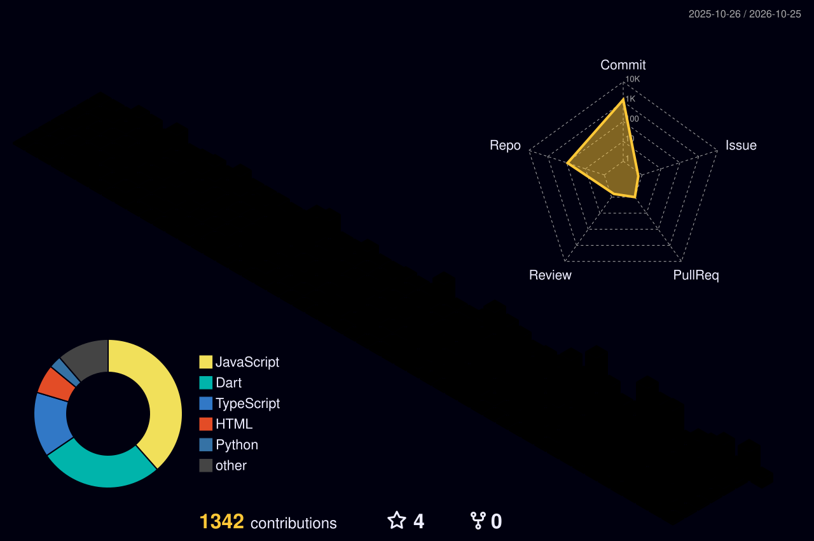

# 👋 Hey, I'm Mustofa

  

---

## 🐍 Contribution Journey

  <picture>
    <source
      media="(prefers-color-scheme: dark)"
      srcset="https://raw.githubusercontent.com/Mustofa12312/Mustofa12312/output/github-contribution-grid-snake-dark.svg"
    />
    <source
      media="(prefers-color-scheme: light)"
      srcset="https://raw.githubusercontent.com/Mustofa12312/Mustofa12312/output/github-contribution-grid-snake.svg"
    />
    
  </picture>

---

- 🚀 Building web and mobile applications to solve real-world problems.
- 🛠️ Exploring scalable architectures, clean code, and reliable APIs.
- 🤖 Learning AI, automation, and modern development workflows.
- 🌱 Working toward becoming a stronger fullstack engineer.
- 🤝 Open to collaboration, open-source projects, and new ideas.

---

## 📊 GitHub Analytics

  

---

## ⚡ Technology Arsenal

### Languages

### Frontend & Mobile

### Backend & Database

### Developer Tools

---

## 🚀 Featured Projects

### 🔍 Project Highlights

| Project | Description | Stack |
|---|---|---|
| 📚 [Digital Library](https://github.com/Mustofa12312/digital_library) | Digital library and lending management | JavaScript |
| 💰 [Catatan Keuangan](https://github.com/Mustofa12312/catatan_keuangan) | Personal finance tracking application | Flutter, Dart |
| 📊 [Data Uang MDR](https://github.com/Mustofa12312/data_uang_mdr) | Financial data and bookkeeping | JavaScript |
| 🏫 [Pondok Administrasi](https://github.com/Mustofa12312/aplikasi_pondok_administrasi) | Administration for Islamic boarding schools | Flutter |

---

## 🔭 Currently Exploring

| Focus | Mission |
|:---:|---|
| 📱 Mobile Engineering | Advanced Flutter UI, animations, and app architecture |
| ⚙️ Backend Engineering | API design, security, and scalable services |
| 🤖 AI & Automation | Python, LLM integrations, and intelligent agents |
| ☁️ Cloud & DevOps | Docker, deployment, and CI/CD pipelines |
| 🧠 Software Architecture | Maintainable code, testing, and system design |

---

## 🐍 Contribution Journey

<!-- Optional: Enable the snake workflow to generate these files. -->

---

## 🤝 Let's Build Something Great

### *"The best way to predict the future is to build it."*

Have an idea, a project, or an interesting challenge?

**Let's connect, collaborate, and create something meaningful.**

  

Designed with curiosity, powered by code, and improved with every commit.

